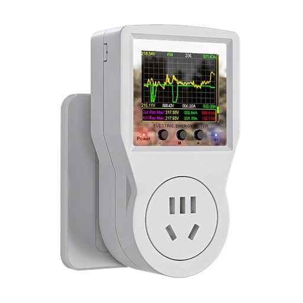
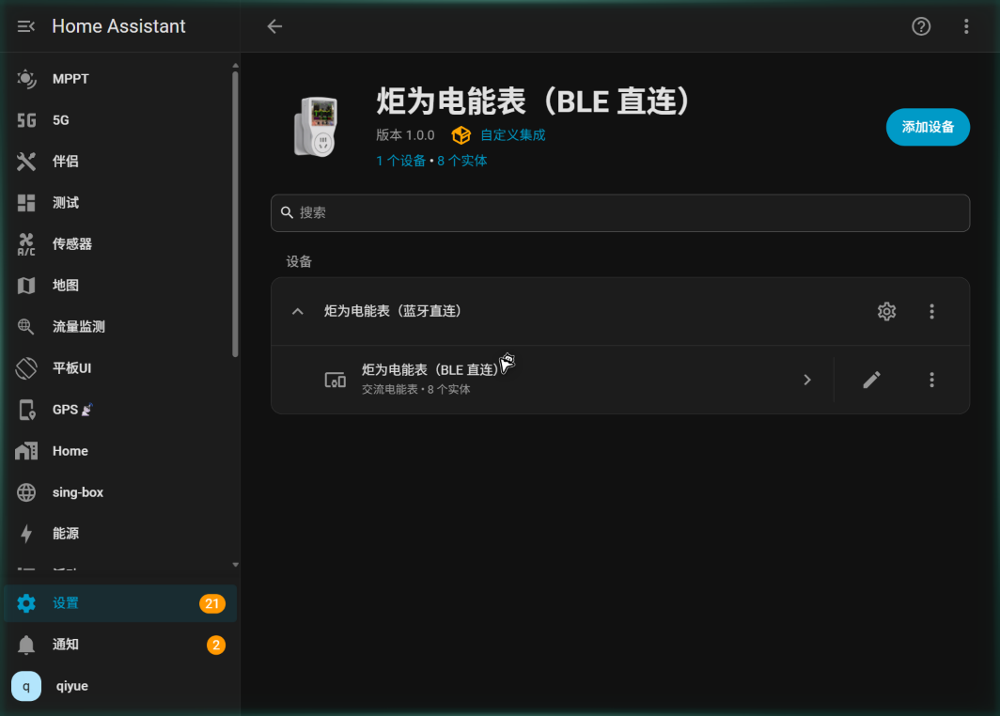
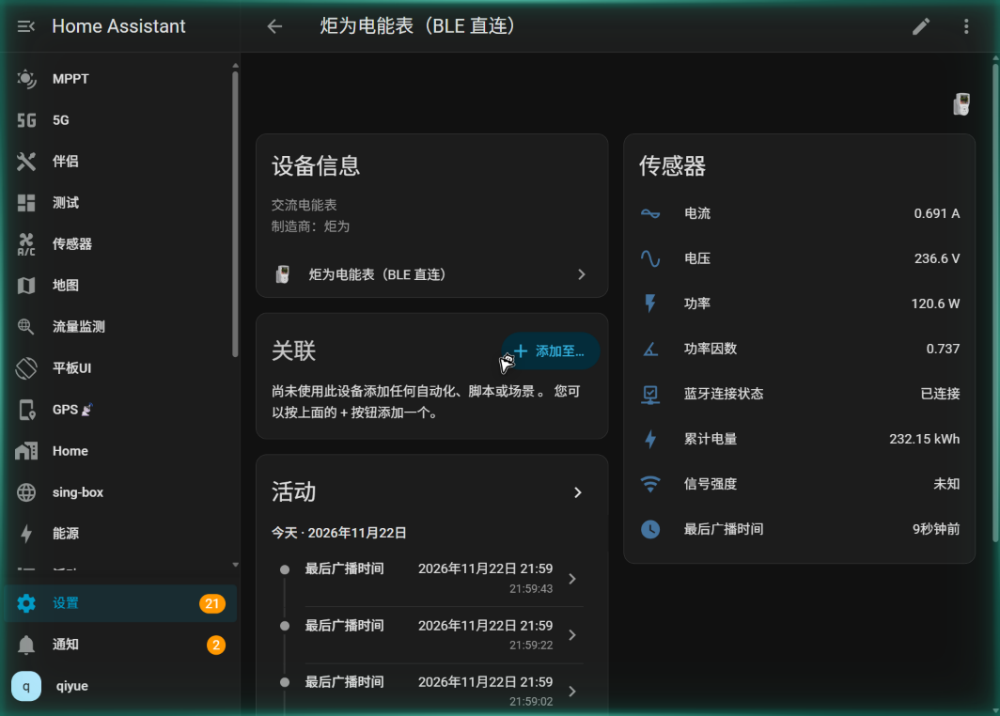

# 炬为电能表（BLE 直连）for Home Assistant

> **我为什么分享到社区**  
> 一路走来，我在社区看了很多前辈的帖子、抄了很多作业，受益良多。**人人为我，我为人人**——现在也把自己跑通的东西整理出来还给大家，就一点分享精神：少一点重复折腾，多一点本地可控。欢迎大家拿去用、拿去改，也欢迎反馈问题，一起把家里的设备都握在自己手里。

> 炬为 / Atorch 交流电能表（S1BWP 等 FFE0/FFE1 协议机型）原生接入 Home Assistant 的自定义集成。
> 不依赖涂鸦云、不依赖厂商 App —— 直接走蓝牙，把电参数据变成 HA 原生实体。

---

## 集成页面与实体状态

接入完成后，Home Assistant 中会出现一个独立的「炬为电能表（BLE 直连）」集成条目，下面挂 1 台设备和 8 个实体。以下截图来自实际运行中的 HA 页面：

*集成详情页：显示「炬为电能表（BLE 直连）」、1 个设备、8 个实体，并可直接进入设备与实体列表。*

*设备详情页：电压、电流、功率、功率因数、累计电量，以及蓝牙连接状态、信号强度、最后广播时间一目了然。*

---

## 为什么做这个集成

这类炬为交流电能表，官方给的两条路都不好用：

| 原来的方式 | 痛点 |
|---|---|
| **涂鸦（Tuya）接入** | 数据要绕一圈涂鸦云，依赖账号和云端；所谓"快速刷新"最短也要 **5 分钟** 一次，做实时功率、自动化联动根本不够用。 |
| **官方电能表 App（E-test / PowerMeter）蓝牙连接** | 只能用手机 App 看，数据锁在手机里；App 一占着蓝牙，Home Assistant 就连不上，两边还会互相抢连接。 |

**这个集成彻底绕开这两条限制：**

- ✅ **不走涂鸦云、不开厂商 App** —— 电能表通过蓝牙代理（BLE Proxy）或直接蓝牙，直接连进 Home Assistant，纯本地、离线可用。
- ✅ **1 秒刷新** —— 设备上电后约每秒主动推一帧，集成默认按 1 秒把最新数据写入实体；对比涂鸦的 5 分钟，快了 **300 倍**，能真正盯实时功率、做自动化联动。
- ✅ **原生 HA 实体** —— 5 个电参传感器 + 3 个蓝牙链路诊断实体，可直接进历史曲线、Energy 能源看板、自动化和告警。
- ✅ **兼容蓝牙代理** —— 手机 BLE Proxy、ESPHome 蓝牙代理、HA 主机蓝牙适配器都能用；换代理、断线后自动重连、指数退避。
- ✅ **全 UI 配置** —— 添加设备、改名、改刷新/重连间隔都在界面里完成，不用碰一行代码。
- ✅ **多台设备** —— 每台独立配置、独立实体。

## 功能一览

| 功能 | 说明 |
|---|---|
| 添加设备 | UI 里自动列出当前蓝牙发现到的电能表，点选即可；也支持手动填 MAC 地址 |
| 1 秒刷新 | BLE notify 推送后按刷新间隔写入 HA，默认 1 秒，可在选项里调到 1~3600 秒 |
| 断线重连 | 连接异常自动重连，失败时指数退避（最长 60 秒）并清 GATT 缓存，适配代理切换 |
| 蓝牙诊断 | 连接状态、信号强度（RSSI）、最后广播时间三个实体，链路健康一目了然 |
| 多设备 | 每台一个 config entry，unique_id = `<MAC>_<字段>`，互不干扰 |
| 可选 YAML 导入 | 支持 `devices:` 批量预置，平时完全用 UI 即可 |

## 接入的实体

每台电能表创建 **8 个实体**（同一台设备下）：

### 电参传感器（5 个，来自设备 36 字节帧）

| 实体 | 说明 | 单位 | 设备类 |
|---|---|---|---|
| 电压 | 实时电压 | V | voltage |
| 电流 | 实时电流 | A | current |
| 功率 | 实时有功功率 | W | power |
| 功率因数 | Power Factor | — | power_factor |
| 累计电量 | 累计用电量，单调增加 | kWh | energy (total_increasing) |

### 蓝牙链路诊断（3 个）

| 实体 | 说明 |
|---|---|
| 蓝牙连接状态 | GATT 连接是否在线（离线显示"已断开"，不误报"不可用"） |
| 信号强度 | RSSI（dBm） |
| 最后广播时间 | 最近一次收到广播 / 数据帧的时间 |

## 安装

### 方式一：HACS（推荐）

1. HACS → 右上角三个点 → **自定义仓库**
2. 仓库地址填：`https://github.com/qiyuetx/juwei-meter-hacs`
3. 类别选 **Integration（集成）** → 添加
4. 搜索「炬为电能表」→ 下载 → 重启 Home Assistant

也可直接点一键添加：

### 方式二：手动安装

把 `custom_components/juwei_meter/` 整个目录复制到 HA 配置目录的 `custom_components/` 下，重启 HA。

## 配置

1. **设置 → 设备与服务 → 添加集成**，搜索「炬为电能表（BLE 直连）」
2. 选择发现到的电能表 MAC，或选「手动输入」填 MAC
3. 设置设备名称、**刷新间隔**（默认 1 秒）、**重连间隔**（默认 5 秒）
4. 完成

之后在集成的「选项」里可随时改 MAC / 名称 / 两个间隔，保存后自动重连生效。

> 前提：HA 需要能"看到"这台电能表的蓝牙广播。本机蓝牙适配器，或任意 ESPHome / 手机 BLE Proxy 均可（HA 的 `bluetooth` 集成需已启用）。

## 协议说明（供进阶用户）

逆向自官方 App，与 Android 端 `PowerMeter.parse()` 完全一致：

- GATT Service：`0000ffe0-0000-1000-8000-00805f9b34fb`
- Notify Characteristic：`0000ffe1-0000-1000-8000-00805f9b34fb`
- 帧长 36 字节，帧头 `FF 55`，设备约每秒主动推一帧
- 字段解析：

| 量 | 字节 | 换算 |
|---|---|---|
| 电压 | byte[4..6] | `/10` |
| 电流 | byte[7..9] | `/1000` |
| 功率 | byte[10..12] | `/10` |
| 累计电量 | byte[13..16] | `/100` |
| 功率因数 | byte[22..23] | `/1000`（>1.5 视为无效） |

集成只订阅 notify、被动解析，不主动打断设备；刷新间隔只控制"多久往 HA 写一次"，BLE 连接始终在线。

## 常见问题

**Q：为什么不走涂鸦 / 官方 App？**
A：涂鸦要绕云且最快只有 5 分钟刷新；官方 App 会独占蓝牙、和 HA 抢连接。本集成走本地 BLE，绕开两者。

**Q：刷新间隔设 1 秒会不会写爆数据库？**
A：设备本来约 1 秒一帧，默认 1 秒写入是原生的实时效果。若嫌 recorder 数据多，可在选项里调大到 5~10 秒。

**Q：换了蓝牙代理后连不上？**
A：集成会在连续失败时清 GATT 缓存并指数退避重试，等代理释放旧连接槽后自动恢复。

## 许可证

[MIT](LICENSE) © qiyuetx
